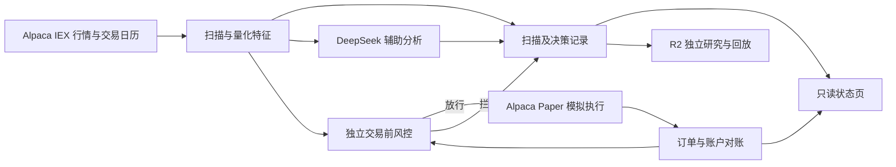

# Paperbot

Paperbot 是一套面向美股的模拟交易与量化研究系统。它按交易日历读取行情，用明确的规则筛选股票，在独立风控放行后才向 Alpaca Paper 提交模拟订单。每轮扫描、风控结论和成交结果都有各自的记录，可以复盘程序为什么下单、为什么等待，以及模拟仓位如何变化。

项目最初用 **100 虚拟 USDT** 跑 BTC/USDT 实验，后来独立开发了以 **10,000 虚拟美元** 为基准的美股试运行。两条链路使用各自的行情、执行程序和账本。

## 程序怎样做决定

| 环节 | 做什么 | 读到的结果 |
| --- | --- | --- |
| 行情与交易日历 | 从 Alpaca 读取 IEX 行情，识别美东时区、休市和提前收盘。扫描使用已收盘的 15 分钟 K 线 | 行情时间、数据来源和扫描候选 |
| 量化与研究 | 计算趋势、波动和流动性相关特征，用成本和时间顺序约束回放 | 候选、分数和验证结果 |
| DeepSeek 辅助 | 在独立流程中生成结构化分析摘要和风险提示 | 可阅读的分析记录 |
| 交易前风控 | 检查行情时效、现金、仓位、单笔风险、日亏损、回撤和账户状态 | 放行或拦截原因 |
| Alpaca Paper | 执行现金约束下的整股做多模拟，跟踪订单与保护单，核对模拟账户和本地账本 | 委托、实际模拟成交、持仓与保护状态 |
| 状态页 | 汇总最近扫描、分析、盈亏、持仓和订单 | 供人查看的运行状态 |



状态页上的「扫描候选」表示有标的进入评估。「模拟成交」确认后才计入持仓。「未结订单」可能是等待成交的买入单，也可能是已持仓标的的卖出保护单。运行频率、信号频率和成交频率各自独立。IEX 是单一交易场所的数据源，扫描覆盖取决于数据权限与可用行情。

## 仓库结构

| 路径 | 内容 |
| --- | --- |
| [`work/us-equity/paperbot_us/`](work/us-equity/paperbot_us) | 美股行情、扫描、风控、模拟执行、保护单、对账、回放和状态汇总 |
| [`work/us-equity/tests/`](work/us-equity/tests) | 美股主程序的离线测试 |
| [`work/us-equity/research/r2/`](work/us-equity/research/r2) | 特征、市场状态、模型、漂移和比较评估的研究代码及测试 |
| [`work/us-equity/deploy/`](work/us-equity/deploy) | Linux 服务和定时器参考配置 |
| [`work/paperbot/`](work/paperbot) | 早期 Freqtrade BTC/USDT dry-run、DeepSeek 助手、阈值优化和状态页 |
| [`outputs/zoneinfo/`](outputs/zoneinfo) | 用于离线验证美东交易时段的 IANA 时区数据 |

## 本地验证

先运行离线测试。以下命令从仓库根目录运行，需要 Python 3.10+，可以在未配置券商和模型密钥的环境执行。

**Windows PowerShell**

```powershell
$env:PYTHONTZPATH = (Resolve-Path './outputs/zoneinfo').Path
Push-Location './work/us-equity'
try {
    python -B -m unittest discover -s tests -v
} finally {
    Pop-Location
}
```

**Linux**

```bash
export PYTHONTZPATH="$PWD/outputs/zoneinfo"
cd work/us-equity
python3 -B -m unittest discover -s tests -v
```

行情扫描使用 `ALPACA_PAPER_KEY_ID` 和 `ALPACA_PAPER_SECRET_KEY`。DeepSeek 助手从独立的运行环境读取密钥。使用自己的模拟账户与专用凭据，并将凭据保存在仓库外。Linux 服务配置需要按目标机器审查路径、用户和权限。旧实验的运行方式见 [BTC 模拟实验](work/paperbot/README.md)。

## 验证与研究边界

- **美股试运行**已有扫描、模拟执行、保护单、对账和状态汇总的实现。试运行数据应按行情覆盖、成本、回撤和样本外表现分别评估。
- **R2 研究**包含市场状态、模型比较和漂移检测的代码。研究结果需要经过时间滚动验证、成本敏感性检查和影子观察，才进入独立的模拟策略验收。
- **资金与数据**均按模拟环境设计。仓库包含源代码、测试样例与部署参考，账户账本、真实运行日志和凭据由各自运行环境保管。

进一步了解 [美股模块入口](work/us-equity/README.md) 和 [研究路线](work/us-equity/RESEARCH_ROADMAP.md)。
